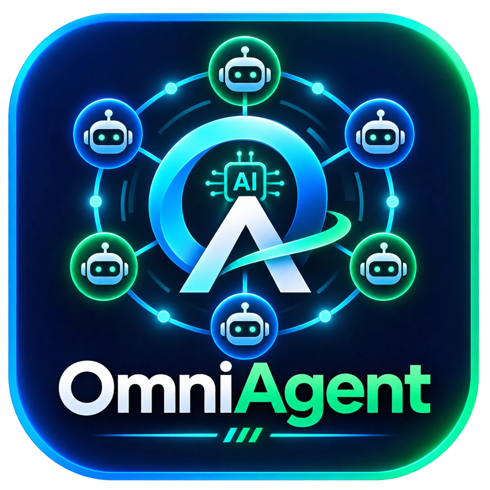

<p align="center"></p>

# OmniAgent

**OmniAgent** is a Windows-first, privacy-focused desktop AI assistant built with Electron, React, TypeScript, and a local Python FastAPI backend. It provides a system-wide AI overlay that securely integrates with your local LLMs (like LM Studio or Ollama) to assist you across any application.

OmniAgent is completely local-first. It processes your screen context, clipboard, and text selections locally, and requires explicit user approval before performing any actions like pasting or modifying text.

## 🌟 Key Features

- **System-Wide AI Overlay**: Press `Ctrl + Alt + A` to summon the OmniAgent overlay above any active window.
- **Local Context Awareness**: Intelligently captures your active window title, clipboard, and selected text locally to provide relevant AI assistance.
- **Bring Your Own Local Model**: Seamlessly connects to local OpenAI-compatible endpoints like **LM Studio** and **Ollama**.
- **Privacy by Design**: All processing happens locally. No data is sent to the cloud unless you explicitly configure a remote endpoint. No secrets are stored permanently.
- **Safe Execution**: OmniAgent operates on a "Preview & Confirm" model. It will never scrape your screen automatically or paste text without your explicit "Confirm Paste" click.
- **Bilingual Interface**: Full Arabic and English support with dynamic RTL/LTR layouts.
- **Built-in Workspace**: A local workspace to save your favorite AI generations, notes, and tasks.

## 🚀 Quick Start (Development & Usage)

OmniAgent is primarily designed to be run locally via the terminal during development and daily use.

### Prerequisites
- Node.js 18+
- Python 3.11+
- Windows 10 or Windows 11

### Installation

Clone the repository and install all dependencies:

```powershell
# Install Node modules and setup Python virtual environments
npm run install:all
```

### Running the App

To start OmniAgent locally (this launches the backend server and opens the Electron desktop app directly):

```powershell
npm run app
```

### Verifying the Setup

To ensure your local backend, provider configurations (like LM Studio), and UI are working correctly, run the built-in QA script:

```powershell
npm run qa
```

## 📦 Optional: Building a Release

If you want to generate a standalone `.exe` installer for Windows (e.g., to share with others or install permanently without using the terminal), you can package the app:

```powershell
# Compiles the React frontend
npm run build:desktop

# Packages the Electron app and bundles the Python executable
npm run package:desktop
```
The final installer will be located in `apps/desktop/release/`.

## 🛡️ Security & Privacy Core Rules

OmniAgent is designed with strict boundaries to protect your system:
- **No Telemetry**: No tracking or silent data harvesting.
- **No Unsafe Execution**: The app does not have features to execute terminal commands, delete files, or automate your browser.
- **Explicit Consent**: Selected-text capture and screenshot metadata are disabled by default.
- **No Secret Storage**: API keys are intentionally not saved in the app's database. For remote providers, keys are only read securely from environment variables.

## 📁 Project Structure

```text
OmniAgent/
├── apps/
│   ├── backend/   # FastAPI service (Local context capture & LLM routing)
│   └── desktop/   # Electron + React + TypeScript shell (UI & Overlay)
├── docs/          # Product specs, architecture, and safety rules
├── scripts/       # Windows setup and health scripts
└── PROJECT_STATUS.md
```

## 📚 Documentation
For detailed insights into the architecture and product specs, check out the `docs/` folder:
- [Product Specification](./docs/PRODUCT_SPEC.md)
- [Architecture](./docs/ARCHITECTURE.md)
- [Safety Rules](./docs/SAFETY_RULES.md)
